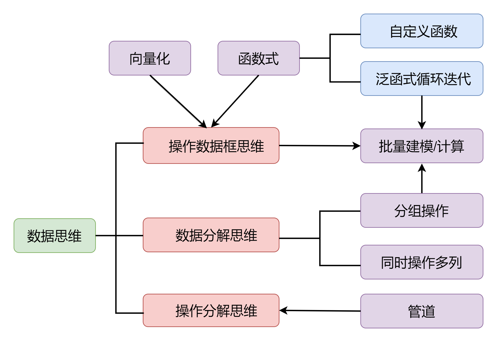

```{r setup, include=FALSE}
knitr::opts_chunk$set(
  include = TRUE,
  echo = TRUE, 
  warning = FALSE, 
  message = FALSE, 
  fig.align = "center")
options(tibble.print_max = 10, tibble.print_min = 6)
library(showtext)
showtext_auto()
```


**关于作者**：

- 张敬信，哈尔滨商业大学，数学与应用数学，副教授
- 热爱学习，热爱编程，热爱R语言
- 我的代表作《R语言编程：基于tidyverse》已于2023年2月正式上市，荣登2023年度人邮畅销新书榜第5名，[异步社区](https://www.epubit.com/bookDetails？id=UB7db2c0db9f537)、[京东](https://item.jd.com/13624993.html)、[天猫](https://detail.tmall.com/item.htm？abbucket=15&id=697658841742)、[当当](https://product.dangdang.com/29508562.html)等各大平台有售：

```{r echo=FALSE, out.width="50%"}

```

本书在系统梳理`tidyverse`数据操作逻辑的基础上，创造性地提出了数据编程思想，可以说是解决一切数据操作问题的指导性思想：

```{r echo=FALSE, out.width="85%"}

```

该思维导图的快速解读，可参阅[优雅数据编程思维（实例阐述）](https://zhuanlan.zhihu.com/p/626467210)。

- 本书免费学习资源：[课件和鲸在线版（可调试代码）](https://www.heywhale.com/mw/project/641dc0d4feb4fe02b2ce72f7) ，[知乎交流平台](https://zhuanlan.zhihu.com/p/467134727)，欢迎您的阅读品鉴、交流讨论！

- 本书的QQ读者1群、2群：875664831、222427909, 交流、答疑，欢迎您的加入！

- 我的下一部著作《`R`机器学习：基于`mlr3verse`》即将上市，也可以关注我的`R`基础、`R`机器学习培训班！

\newpage

本数据操作练习难度相当大，可作为数据操作高级篇，建议先学习入门篇和中级篇：[玩转数据处理120题-tidyverse版（2024）](https://gitee.com/zhjx19/tidyverse120)、[SQL经典50题-tidyverse版（2024）](https://gitee.com/zhjx19/sql50)。

这是任坤的69个[`R`数据操作练习](https://github.com/renkun-ken/r-data-practice)的`tidyverse`版答案，中间我给增加1道题（第`43`题）。这些数据练习基于一个股票价格数据集构建，包含诸如股票代码、日期和价格等变量，涵盖了常见的数据操作实践以及高级操作滑窗迭代、批量建模，旨在帮助用户建立坚实的数据清洗/操作技能。

任坤并未提供这些练习的答案，`Ravin515`给出了[`data.table`版本答案](https://github.com/Ravin515/r-data-practice/tree/master), 完成并校对到63题。

特别感谢@Ravin515的`data.table`解法提供的解题思路和结果对照，节省了大量的思考和调试时间。感谢@楚新元建议并纠正收益率加权标准差的计算，感谢@高孝安指出若干错误，并为`66、68`题提供了非常巧妙的解法。

顺便我也对`data.table`版本答案做了大量简化改写，可参阅`data-table-solutions.R`。

2026年，管道符从 `|>` 换成 `|>`，改用 `pdf-engine: lualatex`。

**说明：**有些中间结果可以被相邻多题使用，为了避免重复计算和产生过多新变量，都统一赋值为`temp`，所以遇到`temp`往前找离得最近的赋值即可。

```{r}
library(tidyverse)
library(slider)
dat = read_rds("data/stock-market-data.rds") |>  
  as_tibble()
```

数据集为“面板数据”：包含多个股票（横截面），而每个股票则有多个按照日期排序的变量（时间序列）

股票代码`symbol`和日期`date`共同组成了数据集的键，也即每个唯一的`symbol`和`date`组合决定了一个唯一的观测。

整个数据集首先按照代码`symbol`排列，其次按照日期`date`排列。

若干主要变量说明：

-   `symbol`：股票代码。`.SH`结尾的是沪股，`.SZ`结尾的是深股
-   `date`：日期
-   `pre_close`： 昨收盘
-   `open`：开盘价
-   `high`：最高价（日内）
-   `low`：最低价（日内）
-   `close`：收盘价
-   `volume`：成交量
-   `amount`：成交金额
-   `capt`: 流通市值
-   `industry`：行业
-   `index_w50`：该股票在上证50指数的成分比例
-   `index_w300`：该股票在上证300指数的成分比例
-   `index_w500`：该股票在中证500指数的成分比例

收益率列反复用到，先计算出来：

```{r}
dat = dat |> 
  mutate(ret = close/pre_close - 1)
```

## Part I

### 1. 哪些股票的代码中包含"8"这个数字？

- 根据条件**筛选行**：是否能从股票代码中检测到“8”
- 对股票代码**去重**（也可以先做这步）

```{r}
dat |> 
  filter(str_detect(symbol, "8")) |> 
  distinct(symbol)
```

### 2. 每天上涨和下跌的股票各有多少？

**解法一：**

- 将收盘价之差**重编码**为上涨、下跌、平稳
- 按日期、涨跌**分组计数**

```{r}
temp = dat |> 
  mutate(UpDown = case_when(close - pre_close < 0 ~ "Down",
                            close - pre_close > 0 ~ "Up",
                            .default = "Steady")) 
temp |> 
  count(date, UpDown)
```

**解法二：**

- 直接做**分组汇总**：对每天满足条件求和（`TRUE`、`FALSE`将作为`0`、`1`），即计算每天满足条件的数量

```{r}
dat |> 
  summarise(UP = sum(close > pre_close), Down = sum(close < pre_close),
            .by = date)
```


### 3. 每天每个交易所上涨、下跌的股票各有多少？

- **修改列：**计算交易所
- 按日期、交易所、涨跌**分组计数**

```{r}
temp |> 
  mutate(exchange = str_sub(symbol, -2, -1)) |> 
  count(date, exchange, UpDown)
```

### 4. 沪深300成分股中，每天上涨、下跌的股票各有多少？

- 根据条件**筛选行**
- 按日期、涨跌**分组计数**

```{r}
temp |> 
  filter(index_w300 > 0) |> 
  count(date, UpDown)
```

### 5. 每天每个行业各有多少支股票？

- 按日期、行业**分组计数**

```{r}
dat |> 
  count(date, industry)
```


### 6. （每天）股票数最大的行业和总成交额最大的行业是否总是同一个行业？

- **分组汇总**：计算每天每个行业的成交额和（唯一值）股票数；
- **分组行切片**每天的最大成交额、每天的最大股票数；
- 二者取交集（做**内连接**）即表示两个最大来自同一天、同一个行业

```{r}
temp = dat |> 
  summarise(trd_amount = sum(amount), stk_num = n_distinct(symbol),
            .by = c(date, industry)) 
slice_max(temp, trd_amount, n = 1, by = date) |> 
  inner_join(slice_max(temp, stk_num, n = 1, by = date))
```

### 7. 每天（收益率）涨幅超过$5\%$、跌幅超过$5\%$的股票各有多少？

- 将收益率**重编码**为涨幅超过$5\%$、跌幅超过$5\%$、平稳
- **筛选行**：前两者
- 按日期、涨跌**分组计数**

```{r}
dat |> 
  mutate(updown = case_when(ret < -0.05 ~ "down5%+",
                            ret > 0.05 ~ "up5%+",
                            .default = "steady")) |> 
  filter(updown != "steady") |> 
  count(date, updown)
```

### 8. 每天涨幅前`10`的股票的总成交额和跌幅前`10`的股票的总成交额比例是多少？

**解法一：** 排序再按顺序做行切片

- 按日期、收益率做**行排序**
- **分组行切片**：切每天的前10行和后10行
- **分组汇总**：计算每天涨幅、跌幅前10的总成交额
- **修改列**：计算二者比例

```{r}
dat |> 
  arrange(date, ret) |> 
  slice(1:10, (n()-9):n(), .by = date) |> 
  summarise(bottom10 = sum(amount[1:10]), top10 = sum(amount[11:20]), 
            .by = date) |> 
  mutate(ratio = top10 / bottom10)
```

**解法二：** 直接按最大、最小做行切片

- **最大行切片**、**最小行切片**，**按行合并**，设定`.id`列表明来源：`top`和`bottom`
- 根据日期、来源**分组汇总**成交额（长表）
- **长变宽**：变成`top`和`bottom`两列（宽表），修改列名：加后缀`10`
- **修改列**：计算二者比例

```{r}
bind_rows( 
  top = slice_max(dat, ret, n = 10, by = date),
  bottom = slice_min(dat, ret, n = 10, by = date), .id = "grp") |> 
  summarise(amount = sum(amount), .by = c(date, grp)) |> 
  pivot_wider(names_from = grp, values_from = amount, names_glue = "{grp}10") |> 
  mutate(ratio = top10 / bottom10)
```

### 9. 每天开盘涨停的股票与收盘涨停的股票各有多少？（涨停按照收益率超过$1.5\%$的标准计算）

- **修改列**：计算开盘收益率、收盘收益率
- **分组汇总**，对每天满足条件求和（`TRUE`、`FALSE`将作为`0`、`1`），即计算每天满足条件的数量

```{r}
temp = dat |> 
  mutate(ret_open = open / pre_close - 1, ret_close = close / pre_close - 1) 
temp |> 
  summarise(n_openlimit = sum(ret_open > 0.015),
            n_closelimit = sum(ret_close > 0.015), .by = date)
```

### 10. 每天统计最近`3`天出现过开盘涨停与收盘涨停的股票各有多少支？

[^fn1]: `Ravin515`的`data.table`解法中考虑最近`3`天时不算当天，其实算与不算当天都不影响结果，因为窗口长度都是`3`，只是结果对应的日期错位一天。

每天统计最近3天[^fn1]，这是**滑窗迭代**问题，适合用`slider`包`slide_*()`系列。

[^fn2]: 一般需要单独取出一个窗口（“窗口大小”个的对象构成的向量或列表），调试到想要的结果，再改写成函数。

**滑窗迭代的基本逻辑：**在初始向量上构造正确的滑窗，将在一个滑窗上（“窗口大小”个的对象构成的向量或列表）要做的事情写成函数[^fn2]，剩下的交给`slide`函数：

```{r eval=FALSE}
slide_*(.x, .f, ..., .before=0L, .after=0L, .step=1L, .complete=FALSE)
```


只解释开盘涨停，收盘涨停完全类似：

- 在开盘收益率列上做**滑窗迭代**，筛选满足条件的行，是对每支股票分别筛选行（满足条件的日期），所以用**分组筛选**（`.by = symbol`）
  - 直接返回窗口是否满足某条件的逻辑值（`slide_lgl`）用于`filter`筛选行；
  - 近`3`天的窗口：上`2`天、上`1`天、当天，只需`.before = 2`， `.after = 0`（默认），`.complete = TRUE`设置只要完整窗口，两端不完整窗口为`NULL`；
  - 在（每）一个窗口，`3`个开盘收益率构成的数值向量`x`，判断是都出现过涨停，即是否存在大于`0.015`：`any(x > 0.015)`，所以函数就是`\(x) any(x > 0.015)`

- 以上已经将每天满足最近3天出现过开盘涨停的股票（行）都筛选出来了，只需要统计每天有几行就行了，关于日期**分组计数**即可

```{r}
temp |> 
  filter(slide_lgl(ret_open, \(x) any(x > 0.015), 
                   .before = 2, .complete = TRUE), .by = symbol) |> 
  count(date)
```

```{r}
temp |> 
  filter(slide_lgl(ret_close, \(x) any(x > 0.015), 
                   .before = 2, .complete = TRUE), .by = symbol) |> 
  count(date)
```

### 11. （每支）股票每天的成交额变化率和收益率的相关性如何？

- **分组修改**：分别对每支股票，计算成交额的变化率：当天减去上`1`天除以上`1`天
- **筛选行**：成交额变化率会出现`Inf`和`NA`，过滤掉
- **汇总**：计算相关系数

```{r}
dat |> 
  mutate(change = (amount - lag(amount)) / lag(amount), 
         .by = symbol) |> 
  filter(is.finite(change)) |>
  summarise(rho = cor(change, ret))
```

### 12. 每天每个行业的总成交额变化率和行业（加权）收益率的相关性如何？

加权平均计算公式：
$$
\bar{x}^* = \frac{\sum\limits_{i=1}^n w_i x_i}{\sum\limits_{i=1}^n w_i}
$$

可用自带的`weighted.mean()`函数计算。

- **分组汇总**：计算每天每个行业的总成交额、行业加权收益率，其中权重为流通市值比重：`capt/sum(capt)`，分母表示组内`capt`求和，取决于计算时的具体分组。
- **分组修改**：分别对每个行业计算总成交额关于日期的变化率
- **剔除NA**：变化率包含`NA`，删掉
- **汇总**：计算相关系数

```{r}
dat |> 
  summarise(amount = sum(amount), ret = weighted.mean(ret, capt), 
            .by = c(date, industry)) |> 
  mutate(change = (amount - lag(amount)) / lag(amount),
         .by = industry) |> 
  drop_na() |> 
  summarise(rho = cor(change, ret)) 
```

### 13. 每天市场的总成交额变化率和市场（加权）收益率相关性如何？

市场就是所有的股票构成的整个数据是一组，所以与第`12`题基本一样，除了少了关于行业分组。

```{r}
dat |> 
  summarise(amount = sum(amount), ret = weighted.mean(ret, capt), 
            .by = date) |> 
  mutate(change = (amount - lag(amount)) / lag(amount)) |> 
  drop_na() |> 
  summarise(rho = cor(change, ret))
```

### 14. 每天市场的总成交额的变化率和所有股票收益率的（加权）标准差相关性如何？

[^fn4]: 接受@楚新元建议，将原答案收益率的标准差，改为市场（加权）收益率的标准差，第`15`题也同样处理。

与第`13`题类似，除了将市场（加权）收益率换成市场（加权）收益率的标准差[^fn4]。

加权标准差计算公式：
$$
s^* = \sqrt{\frac{\sum_{i=1}^n w_i(x_i-\bar{x}^*)^2}{\frac{(M-1)}{M} \sum_{i=1}^n w_i}}
$$
其中，$\bar{x}^*$为加权均值，$M$为非零权重的数量。自定义`weighted.sd()`函数来计算：

```{r}
weighted.sd = function(x, w) {
  M = sum(w != 0)
  wm = sum(w * x) / sum(w)
  (sum(w * (x-wm)^2) / (sum(w) * (M-1) / M)) |> sqrt()
}
dat |> 
  summarise(amount = sum(amount), ret_sd = weighted.sd(ret, capt), 
            .by = date) |> 
  mutate(change = (amount - lag(amount)) / lag(amount)) |> 
  drop_na() |> 
  summarise(rho = cor(change, ret_sd))
```

### 15. 每天每个行业的总成交额变化率和行业内股票收益率的标准差相关性如何？

与第`12`题类似，除了将行业（加权）收益率换成行业（加权）收益率标准差。

```{r}
dat |> 
  summarise(amount = sum(amount), ret_sd = weighted.sd(ret, capt), 
            .by = c(industry, date)) |>  
  mutate(change = (amount - lag(amount)) / lag(amount), .by = industry) |> 
  drop_na() |> 
  summarise(rho = cor(change, ret_sd))
```

## Part II

### 16. 上证50、沪深300、中证500指数成分股中，沪股和深股各有多少？

- **宽变长**：`3`个指数占`3`列，变成整洁表：指数名和指数值两列
- 股票类型（沪股、深股）的区分是股票名的后两位，按指数名、日期、股票类型**分组计数**

**注：**股票类型，也可以先修改列计算。

```{r}
temp = dat |> 
  pivot_longer(starts_with("index"), names_to = c(".value","name"),
               names_sep = "_") |> 
  filter(index > 0) 
temp |> 
  count(name, date, type = str_sub(symbol, -2, -1))
```

### 17. 上证50、沪深300、中证500指数成分股中，行业分布如何？

- 按日期、行业**分组计数**

```{r}
temp |> 
  count(name, date, industry)
```

### 18. 每天上证50、沪深300、中证500指数成分股的总成交额各是多少？

- **分组汇总**：计算每个指数、每天的总成交额

```{r}
temp |> 
  summarise(amount = sum(amount), .by = c(name, date))
```

### 19. 上证50、沪深300、中证500指数日收益率的历史波动率是多少？

指数收益率是按指数（占比）求收益率的加权和，波动率是收益率的加权标准差。

- **分组汇总**：计算每天每个指数的日收益率，流通市值之和（用于下一步加权）
- **分组汇总**；计算每个指数日收益率的加权标准差

```{r}
temp |> 
  summarise(ret = sum(index * ret), capt = sum(capt),
            .by = c(date, name)) |> 
  summarise(vol = weighted.sd(ret, capt), .by = name)            
```

### 20. 上证50、沪深300、中证500指数日收益率的相关系数矩阵？

- `across`同时**汇总**多列：`3`个指数分别用来计算收益率加权和，得到`3`个指数日收益率
- **选择列**：除了第`1`列
- 计算相关系数矩阵

```{r}
dat |> 
  summarise(across(starts_with("index"), \(x) sum(x * ret)),
            .by = date) |> 
  select(-1) |> 
  cor()
```

### 21. 上证50、沪深300、去除上证50的沪深300指数日收益率的相关系数矩阵？

与第`20`题类似，除了把第`3`个指数换成：去除上证50的沪深300指数：若`index_w50==0 & index_w300>0`，则取`index_w300`，否则取`0`。

```{r}
dat |> 
  mutate(w300_50 = if_else(index_w50==0 & index_w300>0, index_w300, 0)) |> 
  summarise(across(c(index_w50, index_w300, w300_50), \(x) sum(x * ret)), 
           .by = date) |>  
  select(-1) |> 
  cor()
```

### 22. 每天沪深300指数成分占比最大的`10`支股票是哪些？

- **（分组）最大行切片**：每天分别切片`index_w300`值最大的`10`行
- **选择列**：想只显示`date`和`symbol`

```{r}
dat |> 
  slice_max(index_w300, n = 10, by = date) |> 
  select(date, symbol)
```

### 23. 各个行业的平均每日股票数量从大到小排序是什么？

- **分组计数**：计算每天每个行业有多少支股票
- **分组汇总**：计算各个行业平均每天股票数量`avg`
- **行排序**：按`avg`降序

```{r}
dat |> 
  count(date, industry) |> 
  summarise(avg = mean(n), .by = industry) |> 
  arrange(-avg)
```

### 24. 每个行业每天成交额最大的一支股票代码是什么？

- **（分组）最大行切片**：每个行业每天切片其成交额最大的一行
- **选择列**：只想显示行业、日期、股票代码

```{r}
dat |> 
  slice_max(amount, n = 1, by = c(industry, date)) |> 
  select(industry, date, symbol)
```

### 25. 每个行业每天最大成交额是最小成交额的几倍？

- **筛选行**：只保留成交额为正的行
- **排序行**：依次按日期、行业、成交额升序
- **分组汇总**：计算每天每个行业的组内最大成交额是最小成交额的多少倍

```{r}
dat |> 
  filter(amount > 0) |> 
  arrange(date, industry, amount) |> 
  summarise(times = amount[n()] / amount[1], .by = c(date, industry))
```

### 26. 每个行业每天成交额最大的`5`支股票和成交额总和是多少？

- **（分组）最大行切片**：分别选出每天每个行业成交额最大的`5`行
- **分组汇总**：计算每天每个行业的成交额总和、将每天每个行业的股票代码合并到一起

```{r}
dat |> 
  slice_max(amount, n = 5, by = c(date, industry)) |> 
  summarise(amount = sum(amount), 
            symbol = str_c(symbol, collapse = ","),
            .by = c(date, industry))
```

### 27. 每个行业每天成交额超过该行业中股票成交额$80\%$分位数的股票的平均收益率是多少？

- **分组筛选行**：分别对每个行业每天，根据条件“成交额 $>$ 其$80\%$分位数”
- **分组汇总**：计算每天每个行业的平均收益率

```{r}
dat |> 
  filter(amount > quantile(amount, 0.8), .by = c(date, industry)) |> 
  summarise(avg_ret = mean(ret), .by = c(date, industry)) 
```

### 28. 每天成交额最大的$10\%$的股票的平均收益率和成交额最小的$10\%$的股票的平均收益率的相关系数是多少？

- 分别**分组最大、最小行切片**，选出每天成交额最大、最小的$10\%$，按行合并，并通过`.id`指定来源列
- **长变宽**：将最大、最小的$10\%$分别放到两列上去
- **汇总**：计算这两列的相关系数

```{r}
bind_rows(
  top10 = slice_max(dat, amount, prop = 0.1, by = date) |> 
    summarise(avg_ret = mean(ret), .by = date),
  bottom10 = slice_min(dat, amount, prop = 0.1, by = date) |> 
    summarise(avg_ret = mean(ret), .by = date), .id = "type") |> 
  pivot_wider(names_from = type, values_from = avg_ret) |> 
  summarise(rho = cor(top10, bottom10))
```

**注：**也可以分别计算完`top10`和`bottom10`后，直接用`cor(top10$avg_ret, bottom10$ave_ret)`计算相关系数。

### 29. 每天哪些行业的平均成交额高于全市场平均成交额？

**解法一：**

这是对同一个量，按不同层级做汇总，再将两个汇总合并到一起（上层汇总因为行数少，需要重复出现），最后根据条件筛选行。

- **分组汇总**：计算每天每个行业的平均成交额（`3744`行，多行表）
- **分组汇总**：计算每天平均成交额（`117`行，少行表）
- 通过**左连接**根据日期匹配将二者合并，少行表会自动重复行以配合多行表
- 根据条件**筛选行**：“分平均 $>$ 总平均”

```{r}
temp1 = dat |> 
  summarise(avg_amount = mean(amount), .by = c(date, industry)) 
temp2 = dat |> 
  summarise(avg = mean(amount), .by = date)
temp1 |> 
  left_join(temp2, by = "date") |> 
  filter(avg_amount > avg)
```

```{r include=FALSE}
rm(temp1, temp2)
```


**解法二：**

要做的事情一样：将两个不同层级合并到一起。解法一是少行表被**左连接**到（重复行以匹配）多行表。

现在换个方向，少行表行数变少是因为做的是**分组汇总**（都是唯一值，`117`行），如果改成做**分组修改**，则行数仍保持原数据行数（`276900`行，包含更大量的重复）；然后，在汇总多行表（3744行）时，同时把之前的`276900`行降到`3744`行，用到的汇总函数是取`unique()`。

这样，得到的中间结果与解法一的**分组汇总+左连接**结果是一样的。

```{r eval=FALSE}
dat |> 
  mutate(avg = mean(amount), .by = date) |> 
  summarise(avg_amount = mean(amount), avg = unique(avg),
            .by = c(date, industry)) |> 
  filter(avg_amount > avg)
```

## Part III

### 30. 每天每个股票对市场的超额收益率是多少？

利用公式$R_{it} = \alpha_i + \beta_iR^m_{it} + \epsilon_{it}$，其中$R_{it}$为个股每日的收益率，$R^m_{it}$为市场每日的收益率， 而后进行回归，再计算回归预测值$\overline R_{it}$，最后根据公式$AR_{it} = R_{it} - \overline R_{it}$计算超额收益率。

本题涉及**批量建模**，对每支股票分别拟合回归模型，并计算预测值。

对数据做分组，批量地对每个分组建立同样模型/做同样计算，并提取和使用批量的模型/计算结果，这就是**批量建模/计算**。“笨方法”手动分割数据、写`for`循环实现，再提取、合并结果也能实现。数据思维做法更简洁优雅，仍是纳入到数据框中来做，用到嵌套数据框（列表列）+ `mutate`修改列 + `map`迭代。你只需要解决：一个数据上的建模/计算。

以下是具体实现步骤，为了更好理解批量建模过程，这里故意打断管道展示一些中间结果：

- **分组修改**：分别计算每天对市场（整个数据的所有股票）的收益率（叫做市场加权收益率），其中权重为流通市值比重：`capt/sum(capt)`
- **选择列**：只保留需要的列
- **分组嵌套**：将每个`symbol`的数据嵌到一起构成`data`列（列表列），其每个元素都是一个子数据框），适合后续批量针对每个`symbol`的数据单独建模

```{r}
temp = dat |> 
  mutate(mkt_ret = weighted.mean(ret, capt), .by = date) |> 
  select(date, symbol, ret, mkt_ret, amount) |>  # amount用于第60题
  nest(data = -symbol) 
temp
```

原数据是`276900`行，嵌套（折叠）后是`2425`行，查看`data`列其中一个元素：

```{r}
temp$data[[1]]
```

- **修改列（批量建模和预测）**：通过`map`在`data`列上迭代，对每个子数据框拟合线性回归模型，得到一系列的模型构成的`model`列（列表列）；继续在`model`列上迭代，对每个模型生成预测值向量（每个子数据框有几行，就得到该长度的预测值向量），得到一系列预测值向量构成的`pred`列（列表列）

```{r}
temp = temp |> 
  mutate(model = map(data, \(d) lm(ret ~ mkt_ret, d)),
         pred = map(model, predict))
temp
```

- **解除嵌套**：将折叠的`data`和`pred`列展开，回到原数据框级别（`276900`行）

```{r}
temp = temp |> 
  unnest(c(data, pred)) 
temp
```

- **修改列**：收益率减去预测收益率，得到超额收益率

```{r}
abnr_ret_d = temp |> 
  mutate(abnr_ret = ret - pred, .after = 2)
abnr_ret_d
```

### 31. 每天每个股票对市场去除自身的超额收益率是多少？

[^fn3]: `Ravin515`的`data.table`解法中公式表示上有点问题，稍作了修改。

市场除去每支股票自身的收益率的计算公式[^fn3]：$ret^m_i = \sum_{k = 1, k \ne i}^n \frac {capt_k \cdot ret_k}{\sum_{j = 1, j \ne i}^n capt_j}$。

本题与第`30`题的思路完全相同，除了将“市场加权收益率”换成“去除自身的市场加权收益率”。

单独写个函数来计算“去除自身的市场加权收益率”，按照计算公式翻译来写就是个逐元素`for`循环。

**注：**函数只要是接受数据框中的原列，返回同样长度（等于数据框行数）的向量，都可以用在`mutate`修改列中计算新列。

```{r}
weight_no_self = function(ret, capt) {
  n = length(ret)
  a = double(n)
  for(i in 1:n) a[i] = sum((capt[-i] / (sum(capt)-capt[i])) * ret[-i])
  a
}
dat |> 
  mutate(mkt_ret_out = weight_no_self(ret, capt), .by = date) |> 
  select(date, symbol, ret, mkt_ret_out) |> 
  nest(data = -symbol) |> 
  mutate(model = map(data, \(d) lm(ret ~ mkt_ret_out, d)),
         pred = map(model, predict)) |> 
  unnest(c(data, pred)) |> 
  mutate(abnr_ret = ret - pred)
```

### 32. 每天每支股票对行业的超额收益率是多少？（类似第30题）

第`30`题是每天对市场的收益率（市场加权收益率），本题是每天对行业的收益率，是分别对各个行业内的所有股票计算每天的行业加权收益率。

只需要将第一步**分组修改**，增加分组变量`industry`。

```{r}
abnr_ind_ret_d = dat |> 
  mutate(ind_ret = weighted.mean(ret, capt), .by = c(date, industry)) |> 
  select(date, symbol, ret, ind_ret) |> 
  nest(data = -symbol) |> 
  mutate(model = map(data, \(d) lm(ret ~ ind_ret, d)),
         pred = map(model, predict)) |> 
  unnest(c(data, pred)) |> 
  mutate(abnr_ret = ret - pred, .after = 2)
abnr_ind_ret_d
```

### 33. 每天每支股票对行业去除自身的超额收益率是多少？（类似第31题）

相当于是第`31、32`题的组合，加权计算时去除自身，前面的`weight_no_self()`函数仍适用；计算对行业的收益率，需要增加分组变量`industry`。

```{r}
dat |> 
  mutate(ind_ret_out = weight_no_self(ret, capt), 
         .by = c(date, industry)) |> 
  select(date, symbol, ret, ind_ret_out) |> 
  nest(data = -symbol) |> 
  mutate(model = map(data, \(d) lm(ret ~ ind_ret_out, d)),
         pred = map(model, predict)) |> 
  unnest(c(data, pred)) |> 
  mutate(abnr_ret = ret - pred, .after = 2)
```

### 34. 每支股票每天对市场的超额收益率与对行业的超额收益率的相关系数如何？

(1) 先计算每支股票每天对市场的超额收益率

- 先计算每支股票每天对市场的收益率（市场加权收益率），与第`30`题第一步计算相同
- 接着，不是分别对每支股票的数据做回归，而是所有数据构建一个回归模型
- 用该回归模型进行预测，再用收益率减去该预测值，得到想要的结果
  
```{r}
mkt = dat |> 
  mutate(mkt_ret = weighted.mean(ret, capt), .by = date) 
mdl = lm(ret ~ mkt_ret, mkt)
mkt = mkt |> 
  mutate(abnr_mkt_ret = ret - predict(mdl, mkt)) |> 
  select(date, symbol, abnr_mkt_ret)
```

(2) 再计算每支股票每天对行业的超额收益率

- 跟上面思路完全一样，除了多了对行业分组：分别计算行业加权收益率、分别对行业拟合回归模型

```{r}
ind = dat |> 
  mutate(ind_ret = weighted.mean(ret, capt), .by = c(industry, date)) |> 
  select(date, symbol, industry, ret, ind_ret) |> 
  nest(data = -industry) |> 
  mutate(model = map(data, \(d) lm(ret ~ ind_ret, d)),
         pred = map(model, predict)) |> 
  unnest(c(data, pred)) |> 
  mutate(abnr_ind_ret = ret - pred) |> 
  select(date, symbol, abnr_ind_ret)
```

(3) 将以上两个表根据日期、股票代码匹配合并（左连接），选择这两个超额收益率的列，汇总计算相关系数

```{r}
ind |> 
  left_join(mkt, by = c("date", "symbol")) |> 
  summarise(rho = cor(abnr_mkt_ret, abnr_ind_ret))
```

```{r include = FALSE}
rm(mkt, ind, mdl)
```


### 35. 每天有哪些行业的平均收益率超过市场平均收益率？

与第`29`题类似，对同一个量，按不同层级做汇总，再将两个汇总表合并到一起（少行表需要重复），最后根据条件筛选行。

只是将“成交额”换成了“收益率”。

**解法一**：

```{r}
temp1 = dat |> 
  summarise(ind_ret = weighted.mean(ret, capt), .by = c(date, industry))
temp2 = dat |> 
  summarise(mkt_ret = weighted.mean(ret, capt), .by = date)
ind_mkt = temp1 |> 
  left_join(temp2, by = "date") 
ind_mkt |> 
  filter(ind_ret > mkt_ret)
```

```{r include=FALSE}
rm(temp1, temp2)
```

**解法二**：

```{r eval=FALSE}
ind_mkt = dat |> 
  mutate(mkt_ret = weighted.mean(ret, capt), .by = date) |> 
  summarise(ind_ret = weighted.mean(ret, capt), mkt_ret = unique(mkt_ret),
            .by = c(date, industry)) 
ind_mkt |> 
  filter(ind_ret > mkt_ret)
```


### 36. 每天每个行业对市场的超额收益率是多少？

与第`30`题类似，不同在于层级变了：从每支股票变成每个行业。第`30`题是分组修改仍在日期、股票层面（276900行），本题是分组汇总到日期、行业层面（3744行）。

- 前面步骤就是第`35`题，直接把结果拿过来用
- 接下来是已熟悉的套路：按行业分组嵌套，批量建立回归模型，批量预测，解除嵌套，修改列计算出最终结果

```{r}
ind_mkt |> 
  nest(data = -industry) |> 
  mutate(model = map(data, \(d) lm(ind_ret ~ mkt_ret, d)),
         pred = map(model, predict)) |> 
  unnest(c(data, pred)) |> 
  mutate(abnr_ret = ind_ret - pred)
```

### 37. 每天每个行业对去除本行业后的市场超额收益率是多少？

与第`31`题类似，不同在于层级变了：从每支股票变成每个行业。第`31`题是分组修改仍在日期、股票层面（276900行），本题是分组汇总到日期、行业层面（3744行）；同时，用于加权的成交额，也要汇总到同样层级，再用于加权。

[^fn5]: `Ravin515`的`data.table`解法中公式表示上有点问题，稍作了修改。

- **分组汇总**：计算每天每个行业的行业总加权收益率`ind_ret`和行业总成交额`ind_capt`（3744个）
- **分组修改**：按公式[^fn5]$ret^m_i = \sum_{k = 1, k \ne i}^n \frac {capt_k \cdot ret_k}{\sum_{j = 1, j \ne i}^n capt_j}$分别计算每天去除本行业后的市场总收益率`mkt_ret`，直接使用前文定义的`weight_no_self()`函数
- 接着，对所有数据构建一个回归模型，再用每个行业的市场总收益率减去预测值，得到最终结果

```{r}
temp = dat |> 
  summarise(ind_ret = weighted.mean(ret, capt), 
            ind_capt = sum(capt), .by = c(industry, date)) |> 
  mutate(mkt_ret = weight_no_self(ind_ret, ind_capt), .by = date)  
mdl = lm(ind_ret ~ mkt_ret, temp) 
temp |> 
  mutate(abnr_ret = ind_ret - predict(mdl, pick(everything())), 
         .before = 3)
```

## Part IV

### 38. 每天分别有多少股票是最近连续3个交易日上涨、下跌的？

- 最近连续3个交易日上涨，说的是每一支股票，所以先根据股票**分组筛选**
- 最近连续3个交易日又是**滑窗迭代**问题，（每）一支股票的收益率列沿日期生成长度为3（前2天+当天）的滑窗，每个滑窗是3个收益率构成的数值向量`x`，判断其是否均上涨，即是否均大于$0$，即`all(x > 0)`，故迭代函数就是`\(x) all(x > 0)`；返回结果是逻辑值（该股票当天是否满足最近连续3个交易日上涨），整个得到逻辑值向量，用于`filter`筛选行
- 筛选出来的行，都是最近连续3个交易日上涨的股票名、（当天）日期，要统计每天有多少这样的股票，那就是按日期对股票做**分组计数**
- 同理，每天有多少股票最近连续3个交易日下跌，只需要把`all(x > 0)`换成`all(x < 0)`
- 最后将两组汇总结果，按行合并到一个数据框，`.id`参数表明来源列，自动使用对象名字：`r3day_up, r3day_down`（若没有名字，自动使用`1, 2`）。

```{r}
bind_rows(
  r3day_up = dat |> 
    filter(slide_lgl(ret, \(x) all(x > 0), .before = 2, .complete = TRUE), 
         .by = symbol) |> 
    count(date),
  r3day_down = dat |> 
    filter(slide_lgl(ret, \(x) all(x < 0), .before = 2, .complete = TRUE), 
         .by = symbol) |> 
    count(date), .id = "tag")
```

### 39. 每天分别有多少股票是最近连续3个交易日收益率超过当天市场平均收益率？

- **分组修改**：分别计算每天的所有股票的市场（加权）平均收益率，注意分组修改不改变原数据行数（276900），虽然这里只计算出`117`个唯一值，但是会重复到276900行（效果等同于分组汇总再被左连接进来），将用于跟收益率列做比较
- 最近连续3个交易日，又是滑窗迭代问题；这次判断条件需要两列：收益率、市场平均收益率，所以是`slide2_*()`在两列上做滑窗迭代，只需要提供这两个列名，窗口长度为3（前2天+当天）包含两个长度为`3`的数值向量，相应地，迭代函数是二元函数，用`x`和`y`作参数（对应它俩），判断条件是收益率均大于市场平均收益率，即`x`的`3`个元素分别都要大于`y`的`3`个元素，即`all(x > y)`，故二元函数就是`\(x, y) all(x > y)`，剩下的筛选行和分组计数完全同第`38`题


```{r}
temp = dat |> 
  mutate(mkt_ret = weighted.mean(ret, capt), .by = date) 
temp |> 
  filter(slide2_lgl(ret, mkt_ret, \(x, y) all(x > y), 
                    .before = 2, .complete = TRUE), .by = symbol) |> 
  count(date)
```

### 40. 每天分别有多少股票是最近5个交易日中至少有4个交易日的收益率超过当天市场平均收益率？

类似第`39`题，区别是：

- 滑动窗口变成长度为`5`（前`4`天+当天）
- 判断条件是`5`天至少有`4`天，即满足判断条件的占比$\ge 0.8$，而`mean(判断条件)`就是满足该判断条件的占比

```{r}
temp |> 
  filter(slide2_lgl(ret, mkt_ret, \(x, y) mean(x > y) >= 0.8, 
                    .before = 4, .complete = TRUE), .by = symbol) |> 
  count(date)
```

### 41. 每个月中，个股月收益超过市场月收益1倍以上的股票有哪些？

与第`29`题类似，汇总到两层级再合并，区别是日期变成了月份。

- **修改列：**计算月份变量
- 两层级汇总与合并
- 根据条件筛选行

**解法一**：

```{r}
dat |> 
  mutate(ym = str_sub(date, 1, 6),
         mkt_ret = weighted.mean(ret, capt), .by = date) |> 
  mutate(mkt_m_ret = mean(mkt_ret), .by = ym) |>
  summarise(m_ret = mean(ret), mkt_m_ret = unique(mkt_m_ret), 
            .by = c(symbol, ym)) |> 
  filter(m_ret > 2 * mkt_m_ret)
```

**解法二**：

```{r}
temp = dat |> 
  mutate(ym = str_sub(date, 1, 6),
         mkt_ret = weighted.mean(ret, capt), .by = date) 
temp |> 
  summarise(m_ret = mean(ret), .by = c(symbol, ym)) |> 
  left_join(summarise(temp, mkt_m_ret = mean(mkt_ret), .by = ym),
            by = "ym") |> 
  filter(m_ret > 2 * mkt_m_ret)
```

### 42. 每个月中，个股月收益超过行业月收益1倍以上的股票有哪些？

与第`35、41`题类似，相比第`41`题，增加了行业分组变量。

**解法一：**

```{r}
dat |> 
  mutate(ind_ret = weighted.mean(ret, capt), ym = str_sub(date, 1, 6),
         .by = c(industry, date)) |> 
  mutate(m_ret = mean(ret), .by = c(ym, symbol)) |> 
  mutate(ind_m_ret = mean(ind_ret), .by = c(ym, industry)) |> 
  filter(m_ret > 2 * ind_m_ret) |>   
  distinct(symbol, ym, industry, m_ret, ind_m_ret)
```

**解法二：**

```{r}
temp = dat |> 
  mutate(ym = str_sub(date, 1, 6),
         ind_ret = weighted.mean(ret, capt), .by = c(date, industry))
temp |> 
  reframe(industry = unique(industry), m_ret = mean(ret), 
          .by = c(symbol, ym)) |> 
  left_join(summarise(temp, ind_m_ret = mean(ind_ret), .by = c(industry, ym)),
            by = c("industry", "ym")) |> 
  filter(m_ret > 2 * ind_m_ret)
```

**注意：**第二个汇总，不是用的`summarise()`而是用的`reframe()`，两者都是做分组汇总，区别是分组变量`symbol, ym`有多少个分组，`summarise()`的结果数据框就有几行；而`reframe()`不要求每个分组只返回一行。而本题属于行数有增加，因为有`30`支股票同时属于两个行业：

### 43. 找出哪些股票属于不止`1`个行业？

本题是我接着上面注意，增加的一道题。

- 关于股票代码、行业去重（所有可能的组合都只留`1`个）
- 属于不止`1`个行业的股票，即按股票代码分组，元素（行业）个数大于1的分组，用分组筛选行找出来
- 为了更直观，再来个分组合并，将每支股票的所属行业合并到一起

```{r}
dat |> 
  distinct(symbol, industry) |> 
  filter(n() > 1, .by = symbol) |> 
  summarise(industry = str_c(industry, collapse = "_"), .by = symbol)
```

### 44. 每支股票的收益率对市场收益率的相关系数最高的10个股票是哪些？

- **分组修改**：分别计算每天的市场收益率（`117`个值），重复到原数据框`276900`行，以便计算与（每支）股票收益率（`276900`个值）的相关系数
- **分组汇总**：分别计算每支股票的收益率与市场收益率的相关系数
- **最大行切片**：选出相关系数值最大的`10`行


```{r}
dat |> 
  mutate(mkt_ret = weighted.mean(ret, capt), .by = date) |> 
  summarise(cor_coef = cor(ret, mkt_ret), .by = symbol) |> 
  slice_max(cor_coef, n = 10)
```

### 45. 每个行业日收益率的历史波动率是多少？（用日收益率计算标准差）

- **分组汇总**：计算每个行业每天的行业加权日收益率，流通市值之和（将用于计算标准差时加权）
- （对日期）**分组汇总**：计算每个行业日收益率的加权标准差

```{r}
temp = dat |> 
  summarise(ind_ret = weighted.mean(ret, capt), capt = sum(capt),
            .by = c(industry, date)) 
temp |> 
  summarise(ind_vol = weighted.sd(ind_ret, capt), .by = industry) 
```

### 46. 各个行业的日收益率的相关系数矩阵如何？哪两个行业相关性最高、最低？

[^fn6]: 相关系数矩阵主对角线上都是`1`，不排除它们的话，肯定`1`是最大值了；最小值不受它们影响。

- 第`45`题第一步，已经计算出各个行业的日收益率，去掉多余的`capt`列
- 要计算各行业的日收益率的相关系数，需要将每个行业的收日益率放到`1`列，即需要**长变宽**
- 去掉第`1`列日期，是`32`列（`32`个行业）日收益率，计算相关系数矩阵
- 相关系数矩阵，行名列名是`32`个行业，找出（非主对角线上的）最大值[^fn6]，和最小值的位置，取出对应的行名、列名，即最终结果

```{r}
cor_mat = temp |> 
  select(-capt) |> 
  pivot_wider(names_from = industry, values_from = ind_ret) |> 
  select(-1) |> 
  cor() 
which(cor_mat == max(cor_mat[cor_mat != 1]), arr.ind = TRUE) |> rownames()
which(cor_mat == min(cor_mat), arr.ind = TRUE) |> rownames()
```

### 47. 各个行业的收益率对市场收益率的相关系数由高到低排列如何？

- 前面步骤同第`35`题，直接将结果拿过来用
- **分组汇总**：分别计算每个行业的行业收益率与市场收益率的相关系数
- **行排序**：按相关系数降序

```{r}
ind_mkt |> 
  summarise(cor_coef = cor(ind_ret, mkt_ret), .by = industry) |> 
  arrange(-cor_coef)  
```

## Part V

### 48. 每个月总成交额比上个月下降幅度最大的行业是哪个？

- **修改列**：计算月份变量
- 按行业、月份**分组汇总**：计算每个行业的月成交额
- **分组修改**：分别计算每个行业的月成交额降幅
- **筛选行**：月成交额降幅删除缺失、只保留负值（降幅）
- **（分组）最大行切片**：筛选出每月的最大降幅。

```{r}
dat |> 
  mutate(ym = str_sub(date, 1, 6)) |> 
  summarise(ind_m_amount = sum(amount), .by = c(industry, ym)) |> 
  mutate(dn_m_range = ind_m_amount - lag(ind_m_amount), .by = industry) |> 
  filter(!is.na(dn_m_range), dn_m_range < 0) |> 
  slice_min(dn_m_range, by = ym)
```


### 49. 数据当中各支股票的最大回撤幅度是多少？（最大回撤是从一个高点到低点的降幅的最大值）

思路来自`frankzhangsyd`：

- **行排序**：将每股按日期倒序排列
- **分组修改**：分别对每支股票用`cummin()`找出最小的`low`值，`high`减去它即撤回幅度
- **选择列**：只保留结果相关的列
- **（分组）最大行切片**：选出每支股票最大的`1`个回撤幅度

```{r}
dat |> 
  arrange(symbol, -date) |> 
  mutate(rtrt_d = high - cummin(low), .by = symbol) |> 
  select(symbol, rtrt_d) |> 
  slice_max(rtrt_d, n = 1, by = symbol)
```

**注：**最后两步也可以换成一步**分组汇总**：`|> summarise(rtrt_d = max(rtrt_d), .by = symbol)`。


### 50. 每支股票的胜率是多少？（胜率是每天收益率为正数的概率）

- **分组汇总**：计算每支股票收益率为正的占比（对判断条件求均值即满足判断条件的占比）

```{r}
dat |> 
  summarise(gain_ratio = mean(ret > 0), .by = symbol) 
```

### 51. 每支股票的盈亏比是多少？（盈亏比是正收益之和与负收益之和的比值的绝对值）

- **修改列**：重编码，计算收益为正、负的标签列
- **分组汇总**：分别计算每支股票每个标签的收益之和
- **长变宽**：标签列的两个标签作为列名，收益之和拆到这两列
- **修改列**：计算上述两列之比的绝对值

```{r}
dat |> 
  mutate(tag = if_else(ret > 0, "gain", "loss")) |> 
  summarise(ret_pn = sum(ret), .by = c(symbol, tag)) |> 
  pivot_wider(names_from = tag, values_from = ret_pn) |> 
  mutate(gl_ratio = abs(gain / loss)) 
```

### 52. 市场的胜率是多少？（市场收益率为正的概率）

- **分组汇总**：计算每天的市场加权收益率
- **分组汇总**：同第`50`题

```{r}
dat |> 
  summarise(mkt_ret = weighted.mean(ret, capt), .by = date) |> 
  summarise(gain_ratio = mean(mkt_ret > 0))
```

### 53. 市场的盈亏比是多少？（市场中每支股票的市值加权正收益和市值加权负收益之比）

与第`51`题类型，多了先**分组汇总**到每天的市场加权收益率。

```{r}
dat |> 
  summarise(mkt_ret = weighted.mean(ret, capt), .by = date) |> 
  mutate(tag = if_else(mkt_ret > 0, "gain", "loss")) |> 
  summarise(mkt_ret_pn = sum(mkt_ret), .by = tag) |> 
  pivot_wider(names_from = tag, values_from = mkt_ret_pn) |> 
  mutate(gl_ratio = abs(gain / loss))
```

### 54. 每个行业的胜率是多少？

与第`52`题类似，只是增加了行业分组变量。

```{r}
dat |> 
  summarise(mkt_ret = weighted.mean(ret, capt), .by = c(industry, date)) |> 
  summarise(gain_ratio = mean(mkt_ret > 0), .by = industry)
```

### 55. 每个行业的盈亏比是多少？（行业盈亏比是行业内每支股票的市值加权的正收益率和市值加权的负收益率之比）

与第`53`题类似，只是增加了行业分组变量。

```{r}
dat |> 
  summarise(mkt_ret = weighted.mean(ret, capt), .by = c(industry, date)) |> 
  mutate(tag = if_else(mkt_ret > 0, "gain", "loss")) |> 
  summarise(mkt_ret_pn = sum(mkt_ret), .by = c(industry, tag)) |> 
  pivot_wider(names_from = tag, values_from = mkt_ret_pn) |> 
  mutate(gl_ratio = abs(gain / loss))
```

## Part VI

### 56. 是否存在股票的月成交额超过所在行业当月中某天一天总成交额的情况？

又是涉及不同层级的汇总，为了保证相匹配，采用分组修改（保持原数据`276900`行数）。

- **分组修改**：分别计算每个行业每天的总成交额，计算月份（不受分组影响）
- **分组修改**：分别计算每支股票每月的总成交额
- **筛选行**：根据股票月成交额大于行业天总成交额
- **选择列**：只保留想要的列

```{r}
dat |> 
  mutate(ind_d_amount = sum(amount), ym = str_sub(date, 1, 6),
         .by = c(industry, date)) |> 
  mutate(m_amount = sum(amount), .by = c(ym, symbol)) |> 
  filter(m_amount > ind_d_amount) |> 
  select(ym, symbol, industry, m_amount, ind_d_amount)
```

### 57. 每天每个行业编入、编出的股票各有多少？

- **分组汇总（打包）**：将每天每个行业的股票名打包到一起（列表，股票集合）
- **分组修改**：分别对每个行业，计算编入、编出的股票数量作为新列
  - **编入**，就是上一天股票集合里没有，当天的股票集合里有，这样的股票有几支
  - **编出**，就是上一天的股票集合里有，当天的股票集合里没有，这样的股票有几支
  - 每个计算都要用到上一天和当天的股票集合，这是在股票集合列上做长度为`2`的**滑窗迭代**，用`slide()`构建这样的滑窗
  - 每个窗口是两个股票集合构成的列表，用`s`表示，则`s[[1]], s[[2]]`就是上一天和当天的股票集合
  - 第`2`个股票集合与第`1`个股票集合做差集，计算长度，即编入数量；第`1`个股票集合与第`2`个股票集合做差集，计算长度，即编出数量，这两个数量作为命名向量就是想要的每个滑窗的返回结果
  - 将上述在一个窗口做的事情写成函数`ports()`，就是滑窗迭代的函数，该函数的返回值是向量，批量返回结果只能用列表打包到一起，故`slide()`不加后缀

- **解除嵌套**：将新列横向展开，得到两列：编入数量、编出数量
- **选择列**：股票集合列内容太多，删掉不予显示 

```{r}
ports = function(s) c(import = setdiff(s[[2]], s[[1]]) |> length(), 
                      export = setdiff(s[[1]], s[[2]]) |> length())
dat |> 
  summarise(symbol = list(symbol), .by = c(date, industry)) |> 
  mutate(rlt = slide(symbol, ports, .before = 1, .complete = TRUE), 
         .by = industry) |> 
  unnest_wider(rlt) |> 
  select(-symbol)
```

### 58. 每天每个行业内股票收益率的（加权）标准差是多少？

- **分组汇总**：分别计算每天每个行业的股票收益率的加权标准差

```{r}
temp = dat |> 
  summarise(ret_sd = weighted.sd(ret, capt), .by = c(date, industry))
temp
```

### 59. 每天每个行业内股票收益率的（加权）标准差的相关性如何？

第`58`题结果接着做：

- **长变宽**：将行业列的每个行业变成列名，收益率标准差分配到这些列
- **选择列**：删掉第`1`列日期
- 计算相关系数矩阵（$32 \times 32$），只输出部分结果

```{r}
cor_mat = temp |> 
  pivot_wider(names_from = industry, values_from = ret_sd) |> 
  select(-1) |> 
  cor()
cor_mat[1:5, 1:5]
```

### 60. 每天计算出成交额的`z-score`（减去均值除以标准差），该指标能解释下一天个股超额收益率的多少比例？

使用第`30`题计算的超额收益率。

- **分组修改**：分别计算每天的成交额`z-score`
- **分组修改**：分别将每支股票的超额收益率前移`1`位，让成交额`z-score`与下一天超额收益率对齐
- 解释多少比例用二者线性回归的可决系数$R^2$表示，这里直接在汇总中完成回归建模并提取$R^2$（也跳出数据框在外面计算）

```{r}
abnr_ret_d |> 
  mutate(zscore = (amount - mean(amount)) / sd(amount), .by = date) |> 
  mutate(abnr_lead_ret = lead(abnr_ret), .by = symbol) |> 
  summarise(R2 = summary(lm(abnr_lead_ret ~ zscore,
                            pick(everything())))$r.squared)
```

### 61. 每支股票的收益率和300、500指数收益率可以回归出一个截距项和2个beta，这两个beta的分布如何？

- **分组修改**：分别计算每天的300、500指数的总和收益率：指数是占比，收益率乘以占比再加和
- **选择列**：只保留需要的列
- **分组嵌套**：要对每支股票批量回归建模，按股票代码分组嵌套
- **分组修改**：分别对每支股票的嵌套数据框，批量构建收益率关于两指数总和收益率的线性回归模型；继续批量提取两个自变量的回归系数（一系列长度为`2`的向量构成的列表列）
- **解除嵌套**：将回归系数列表列纵向展开，同时指定标签列列名为`tag`，存放每个向量元素（`beta`）的名字：`ind_w300_ret, ind_w500_ret`，将作为分组变量
- **忽略`NA`**：包含`3`行缺失，剔除掉
- **分组汇总**：计算每个`beta`的均值和标准差

```{r}
dat |> 
  mutate(ind_w300_ret = sum(ret * index_w300), 
         ind_w500_ret = sum(ret * index_w500), .by = date) |>
  select(symbol, ret, ind_w300_ret, ind_w500_ret) |> 
  nest(data = -symbol) |> 
  mutate(model = map(data, \(d) lm(ret ~ ind_w300_ret + ind_w500_ret, d)),
         coef_beta = map(model, \(m) coef(m)[-1]), .by = symbol) |> 
  unnest_longer(coef_beta, indices_to = "tag") |> 
  drop_na() |> 
  summarise(sample_mean = mean(coef_beta), sample_sd = sd(coef_beta), .by = tag)
```

### 62. 每天开盘后到最高价涨幅最大的100支股票同样也是全天（昨收到今收）涨幅最大的100支股票的比例是多少？

- **修改列**：计算最高价涨幅、全天涨幅（若按天分组修改也不影响结果）
- **（分组）最大行切片**：分别对每天的最高价涨幅、全天涨幅行切片最大的100支股票，再**分组汇总（打包）**将每天的100支股票合并到一起（列表）
- **左连接**：将两个结果表根据日期匹配合并，结果表是`3`列：日期、两个列表列，即这两个100支股票集合
- **修改列**：计算两个100支股票集合重合的股票数量，即两个100支股票集合取交集再计算元素个数（长度），用`map2_int()`在这两个列表列上迭代，返回整数向量
- 题目中的“同样也是”，即这两个100支股票集合完全重合，也就是重合的股票数量为100，满足判断条件的占比，即`mean(判断条件)`，汇总它即可


```{r}
temp = dat |> 
  mutate(high_open = high/open - 1, clo_pre = close/pre_close - 1)
temp1 = slice_max(temp, high_open, n = 100, by = date) |> 
  summarise(ho_symbol = list(symbol), .by = date) 
temp2 = slice_max(temp, clo_pre, n = 100, by = date) |> 
    summarise(cp_symbol = list(symbol), .by = date)
temp1 |> 
  left_join(temp2, by = "date") |> 
  mutate(len = map2_int(ho_symbol, cp_symbol, 
                        \(x, y) intersect(x, y) |> length())) |> 
  summarise(p = mean(len == 100))
```

```{r include=FALSE}
rm(temp, temp1, temp2)
```

### 63. 每天计算最近三天每天对市场的超额收益率都排进当天前100的股票有哪些？

使用第`30`题计算的超额收益率。

- **（分组）最大行切片**：分别对每天的超额收益率行切片最大的100支股票
- **分组汇总（打包）**：将每天的100支股票合并到一起（列表）
- **修改列**：“最近三天”又是滑窗迭代问题，用`slide()`在股票集合列表列构建前2天+当天的滑窗；每个窗口是三个100支股票集合构成的列表，“都排进当天前100的股票”即同时属于这三个100支股票集合的股票，让它们三个递归地取交集即可，故滑窗迭代函数写为：`\(s) reduce(s, intersect)`，结果仍是列表列，只是每个股票集合变小了，仍赋值给`symbol`，即替换该列
- **解除嵌套**：将结果`symbol`列表列纵向展开

```{r}
abnr_ret_d |> 
  slice_max(abnr_ret, n = 100, by = date) |> 
  summarise(symbol = list(symbol), .by = date) |> 
  mutate(symbol = slide(symbol, \(s) reduce(s, intersect),
                        .before = 2, .complete = TRUE)) |> 
  unnest_longer(symbol)
```

### 64. 每天计算最近三天每天对行业的超额收益率都排进当天行业前$30\%$的股票有哪些？

使用第`32`题计算的行业超额收益率。

- 与第`63`题类似，除了行切片时是按比例切最大的$30\%$。

```{r}
abnr_ind_ret_d |> 
  slice_max(abnr_ret, prop = 0.3, by = date) |> 
  summarise(symbol = list(symbol), .by = date) |> 
  mutate(symbol = slide(symbol, \(s) reduce(s, intersect),
                        .before = 2, .complete = TRUE)) |> 
  unnest_longer(symbol)
```

## Part VII

### 65. 如果市场收益率是市值加权收益率，那么每天超额收益率最大的10支股票是哪些？

第`30`题已计算出每天每支股票对市场的超额收益率，再接着按日期做**（分组）最大行切片**筛选行即可，只保留想要的列。

```{r}
top10_d = abnr_ret_d |> 
  slice_max(abnr_ret, n = 10, by = date) |> 
  select(date, symbol, abnr_ret)
top10_d
```

### 66. 如果市场收益率是市值加权收益率，那么每天超额收益率最大的10支股票下一天的超额收益率排名是多少？

使用第`30`题计算的超额收益率（`abnr_ret_d`）、第`65`题计算的每天超额收益率最大的10支股票（`top10_d`）。

直接借用@高孝安非常巧妙的解法：不是按部就班地平移日期、分别计算、再连接回来，而是直接平移排名、整体计算走了个大大的捷径。

```{r}
abnr_ret_d |>
  select(date, symbol, abnr_ret) |> 
  mutate(rank = rank(-(abnr_ret)), .by = date) |>
  mutate(lead_rank = lead(rank, 1), .by = symbol) |>
  right_join(top10_d) |> 
  arrange(date, rank)
```

### 67. 如果市场收益率是市值加权收益率，那么每月超额收益率最大的10支股票是哪些？

使用第`30`题计算的超额收益率。

- **修改列**：计算月份
- **分组汇总**：对每支股票的日超额收益率按月取平均，得到月超额收益率
- 接着与第`65`题类似，按日期做**（分组）最大行切片**筛选行即可

```{r}
abnr_ret_m = abnr_ret_d |> 
  mutate(ym = str_sub(date, 1, 6)) |> 
  summarise(abnr_m_ret = mean(abnr_ret), .by = c(ym, symbol)) 
top10_m = abnr_ret_m |> 
  slice_max(abnr_m_ret, n = 10, by = ym)
top10_m
```

### 68. 如果市场收益率是市值加权收益率，那么每月超额收益率最大的10支股票下个月的超额收益率排名是多少？

与第`66`题类似，只是从日度数据变成了汇总后的月度数据，`abnr_ret_m`作为查找表，一些变量相应的变成“月”变量。

```{r}
abnr_ret_m |>
  mutate(rank = rank(-(abnr_m_ret)), .by = ym) |>
  mutate(lead_rank = lead(rank, 1), .by = symbol) |>
  right_join(top10_m) |> 
  arrange(ym, rank)
```

### 69. 每支股票过去5天的（平均）收益率与未来1天、5天、15天的收益率的相关性如何？

- **选择列**：只保留需要的列
- **分组修改**：分别计算每支股票收益率过去5天的滑动平均、收益率前移`1`天、`5`天、`15`天
- **忽略`NA`**：滑动平均、前移运在某端会产生`NA`
- **选择列**：只保留要考察的列
- 计算相关系数矩阵

```{r}
dat |> 
  select(symbol, date, ret) |> 
  mutate(lag5 = slide_dbl(ret, mean, .before = 4, .complete = TRUE),
         lead1 = lead(ret), lead5 = lead(ret, 5), 
         lead15 = lead(ret, 15), .by = symbol) |> 
  drop_na() |> 
  select(3:7) |> 
  cor()
```

### 70. 每支股票过去5天的对市值加权市场收益率的（平均）超额收益率与未来1天、5天、15天的超额收益率的相关性如何？

使用第`30`题计算的超额收益率，与第`69`题类似。

```{r}
abnr_ret_d |> 
  select(symbol, date, abnr_ret) |> 
  mutate(lag5 = slide_dbl(abnr_ret, mean, .before = 4, .complete = TRUE),
         lead1 = lead(abnr_ret), lead5 = lead(abnr_ret, 5), 
         lead15 = lead(abnr_ret, 15), .by = symbol) |> 
  drop_na() |> 
  select(3:7) |> 
  cor()
```
